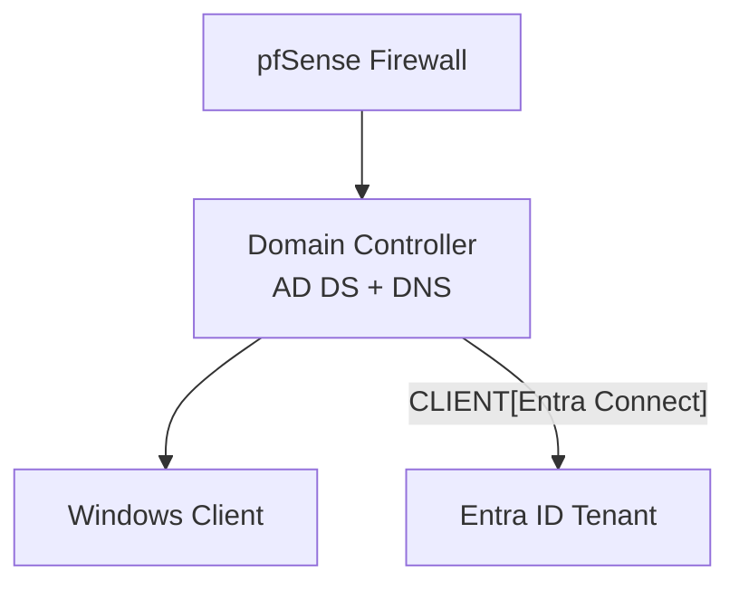

# IAM Home Lab

A hybrid identity lab that connects an on-premises Active Directory environment to Microsoft Entra ID, built to practice real-world identity and access management.

**Status:** 🚧 In progress

## Goals

- Build a hybrid identity environment from scratch
- Practice user lifecycle management, authentication, and access control
- Apply security controls such as MFA and Conditional Access
- Document each step so the lab is repeatable

## Architecture

| Component | Purpose |
|-----------|---------|
| Hypervisor (VMware / Proxmox) | Hosts all lab VMs |
| pfSense | Firewall and network segmentation |
| Windows Server (AD DS) | On-prem domain controller |
| Entra ID tenant | Cloud identity provider |
| Microsoft Entra Connect | Syncs on-prem identities to the cloud |
| Windows 10/11 client | Domain-joined test machine |

## What I Built

1. Network and firewall setup
2. Domain controller and AD configuration (OUs, users, groups)
3. Entra ID tenant and directory sync
4. Authentication (MFA, SSPR)
5. Conditional Access policies
6. Role-based access and least privilege
